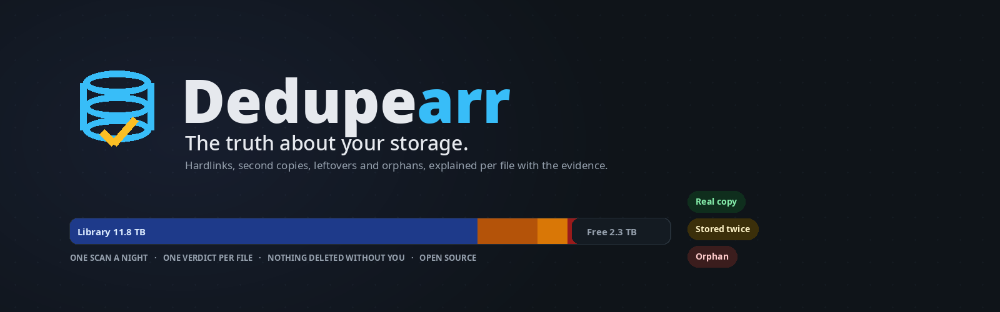
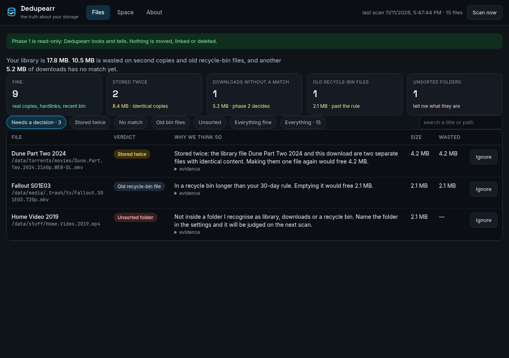
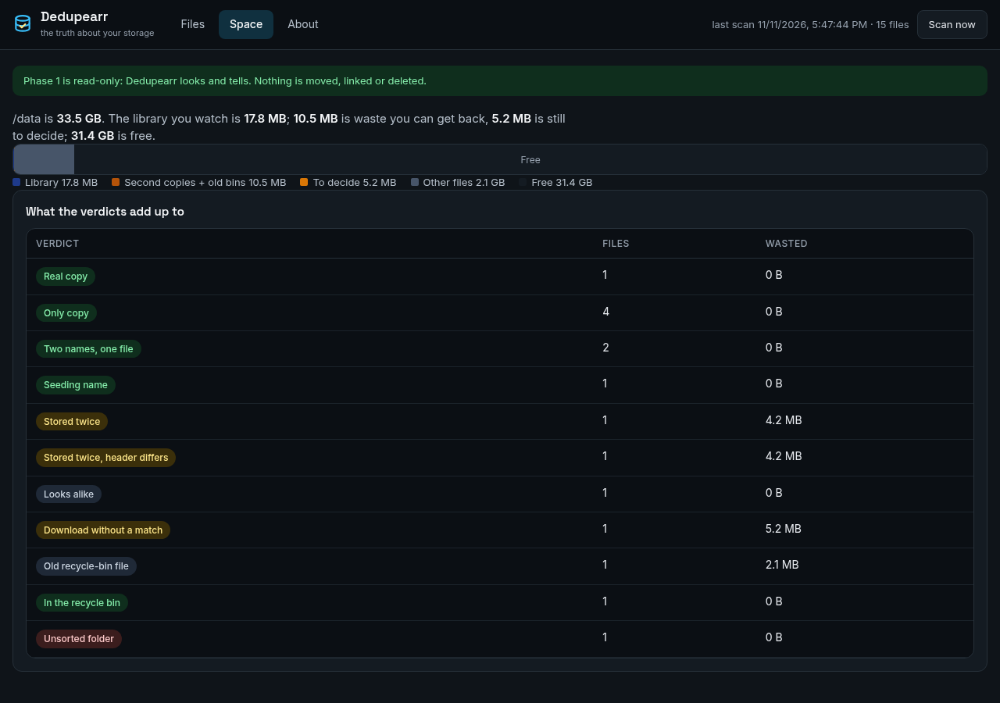
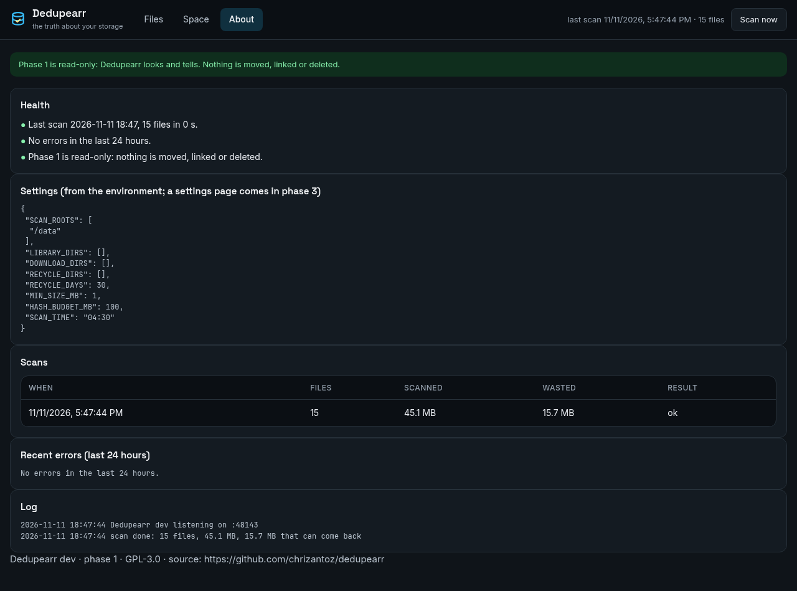
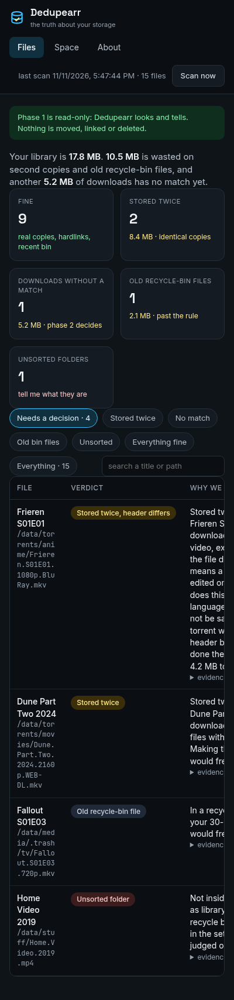
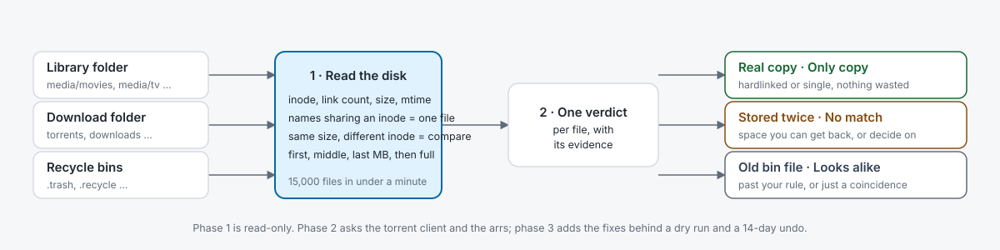

# 💾 Dedupearr



[](https://github.com/chrizantoz/dedupearr/actions/workflows/ci.yml) [](https://github.com/chrizantoz/dedupearr/releases) [](LICENSE) [](docs/INSTALL.md) [](https://dedupearr-demo.chrizantoz.com) [](https://github.com/chrizantoz/dedupearr/pkgs/container/dedupearr)

**Dedupearr tells you the truth about your storage.** If you run **Sonarr**, **Radarr** and a torrent client, your download folder is supposed to share its files with your library through *hardlinks* (two names for one file on disk), so seeding costs no extra space. One wrong path, one copy instead of a link, one upgrade that left the old torrent behind, and the same movie sits on your disk twice. Dedupearr walks every video file each night and says what it *is*, with the evidence, in one plain sentence.

Think of it as the companion to [Auditarr](https://github.com/chrizantoz/auditarr): Auditarr asks *is this file good?*, Dedupearr asks *is this file real and needed?*

- 🧪 **Try it in your browser:** **[dedupearr-demo.chrizantoz.com](https://dedupearr-demo.chrizantoz.com)** is the real app on a fake disk with one of every situation; every button works and it resets on the hour. A static copy of the page lives on the [project site](https://chrizantoz.github.io/dedupearr/).
- 📘 **New here? Start with the [User guide](docs/USER-GUIDE.md)**: a plain-language tour of the page and every button.
- 📋 **Every verdict it gives and every button it has:** [FEATURES.md](FEATURES.md)
- 📰 **What changed and when:** [CHANGELOG.md](CHANGELOG.md)
- 🗺️ **Where it is going:** [ROADMAP.md](ROADMAP.md) · 📦 **Installing step by step:** [docs/INSTALL.md](docs/INSTALL.md)

It is deliberately small: one Python file, one HTML page, a local SQLite file for its state, and no separate database server. It runs as a single Docker container.

## 🚧 Status

**Phase 3 of 4: it can fix what it finds, and every fix can be undone** (as of 2026-11-16). Dedupearr scans, asks your download clients and arrs, and offers a button on the rows it is sure about. Fixes are a dry run until you turn them on (`FIX_MODE=on`); then a file moves to a holding bin first and can be put back for 14 days. It was built on one homelab (about 15,000 files and 35 TB across Sonarr, Radarr, Deluge and NZBGet on Unraid), where it reports about 500 GB that can come back. What is still open before phase 4: 30 nights in a row without a wrong fix. The [roadmap](ROADMAP.md) has the detail.

| Phase | What it does | Status |
| --- | --- | --- |
| 1 · Scan and tell | Disk scan (inode, link count, size, checksum), verdicts, Files and Space pages, nightly scan | done |
| 2 · Ask the apps | Deluge, NZBGet, qBittorrent, rTorrent, Transmission, SABnzbd (found through the arrs' own settings) and the arrs' import history: a download becomes *leftover*, *orphan* or *seeding only*, with your seeding rule saying what can go now. A morning message for your phone. Living next to Auditarr: rows say what Auditarr changed, and its trash is left alone | done (a Plex reader to come) |
| 3 · Fix safely | Relink an identical copy, remove a finished torrent through the client (a whole season pack at once), move orphans and old bin files: dry run first, holding bin, 14-day undo, a lock shared with Auditarr | **built and live**; the 30-night gate is running |
| 4 · Easy to install | Setup wizard with the shared-mount test, Unraid cache/array awareness, Unraid Apps listing | next (the public demo and the Unraid template already exist) |

## 🖼️ Screenshots

Taken by the test bot in CI from the fake disk, so they are always current.

| Files: one verdict per file, with the evidence | Space: where the gigabytes went |
|---|---|
|  |  |

| About: health, settings, every scan | On a phone |
|---|---|
|  |  |

The page follows your system theme; a light version is one setting away.

## 🧭 How it works

<picture><source media="(prefers-color-scheme: dark)" srcset="docs/how-it-works-dark.svg"></picture>

Every night it records every video file's inode, link count and size. Names that share one inode are one file, so a library file and its seeding torrent that are hardlinked cost nothing and are marked **Real copy**. A download that has the same size as a library file is compared by checksum: identical means **Stored twice**, identical except the first megabyte means **Stored twice, header differs** (a language tag was edited on one copy), different means **Looks alike**. A download nothing matches is a **Download without a match** until phase 2 asks the torrent client about it. Recycle-bin files past your rule are **Old recycle-bin files**. Every verdict comes with one plain sentence and one line of evidence.

## 🧰 What you'll need

- Sonarr and/or Radarr with a torrent client, writing to a folder Dedupearr can read. Nothing is connected in phase 1; it only reads the disk.
- Your library **and** your download folder visible through **one mount** (`/data` below), the way the arr guides set it up. If they are two mounts, a hardlink between them cannot exist and Dedupearr cannot see that two names are one file.
- About two minutes to fill in the `docker run` command below.

### Try it without installing

**[dedupearr-demo.chrizantoz.com](https://dedupearr-demo.chrizantoz.com)** runs the real app on the fake disk below, on its own network, and rebuilds itself every hour. `sandbox/run.sh up` starts the same playground on your machine.

### Try it without a library

```bash
python3 tests/fake_disk.py /tmp/dedupearr-fake
CONFIG_DIR=/tmp/dedupearr-cfg SCAN_ROOTS=/tmp/dedupearr-fake MIN_SIZE_MB=1 python3 dedupearr.py --scan
```

The fake disk holds one of every situation: a real hardlink, an identical second copy, a copy whose header was edited, an unmatched download, a lookalike, an old and a recent recycle-bin file, two names inside the library, and an unsorted folder.

## How it works in three steps

1. 🔗 **Mount** the share that holds your library and your downloads and start the container (read-only is enough to look; fixes need it writable).
2. 🌙 **It scans every night** (and once at start): 15,000 files take under a minute. Checksums run only on files that look like copies and are remembered, so a file is hashed once in its life.
3. 👀 **You read one sentence per file**: *Stored twice: the library file Dune Part Two 2024 and this download are two separate files with identical content. Making them one file again would free 48.2 GB.* With fixes on, the row carries the button.

### What it runs on

Inside the container: Python 3.12 and its standard library, nothing else. No database server, no framework. The test bots need Node 20 with `jsdom` and `playwright` (see `uibot/package.json`); none of that ships in the image.

## 🚀 Quick start (Docker)

```bash
docker run -d --name dedupearr --restart unless-stopped -p 3092:3092 \
  -e TZ=America/Winnipeg -v /path/to/appdata/dedupearr:/config -v /path/to/media:/data:ro \
  ghcr.io/chrizantoz/dedupearr:latest
```

Open `http://host:3092`. The first scan starts on its own; after that it runs every night at `SCAN_TIME` (04:30 by default).

Step-by-step for Unraid and docker compose: [docs/INSTALL.md](docs/INSTALL.md). A compose file is in [docs/docker-compose.yml](docs/docker-compose.yml), an Unraid template in [docs/unraid-template.xml](docs/unraid-template.xml).

📁 **Requirements:** the library and the download folders must be inside the one mount (`/data` here). Dedupearr tells library from downloads from recycle bins by folder names (`media`, `movies`, `tv`, `torrents`, `downloads`, `.trash`, `.recycle`, …); when your names differ, say so with `LIBRARY_DIRS`, `DOWNLOAD_DIRS` and `RECYCLE_DIRS`.

## 💬 Help and community

- [GitHub Discussions](https://github.com/chrizantoz/dedupearr/discussions) for questions and ideas, [Issues](https://github.com/chrizantoz/dedupearr/issues) for bugs.
- Unraid users: the Auditarr [support thread](https://forums.unraid.net/topic/201247-support-auditarr-nightly-quality-control-for-your-sonarr-radarr-bazarr-plex-library/) covers Dedupearr too until it has its own.

## 🔒 Who can open the page

Out of the box the page is open to whoever can reach the port, which at home means your local network. On the **About** tab, **Protect the page** sets a user and password (stored hashed in Dedupearr's own database; do it from your own network) and from then on the page asks for a sign-in: a plain login page, a signed session cookie, **Sign out** in the top bar; a new password signs every browser out. `/health` stays open for monitoring. You can also set `AUTH_USER` and `AUTH_PASSWORD` on the container: they win over the page, which is also the way back in if you forget the password.

- **No sign-in at home, sign-in through your domain:** tick **No sign-in on my own network** under the password (or set `LOCAL_NO_LOGIN=1`). A browser on your own network (or tailnet) that opens the address and port directly gets straight in; anything that arrives through a reverse proxy, tunnel or CDN (it adds `X-Forwarded-For` or a similar header) is always asked, even though the proxy itself sits on your network. Leave it off if your router forwards the port straight to Dedupearr: some routers make every outside visitor look like they are at home.
- **Already behind Authelia or Authentik:** `TRUST_PROXY_AUTH=1` lets their `Remote-User` header count as the sign-in, so you log in once.

## 🛡️ Is it safe? (yes: nothing is deleted outright)

- **A dry run until you say otherwise.** Out of the box every **Preview fix** shows the exact steps and nothing is moved, linked or deleted. Mount your media read-only (`:ro`) and that is guaranteed by the system, not only by the code.
- **With fixes on, a file moves before it goes.** Every fix moves the file to a holding bin first. **Put back** undoes it for 14 days; only then is it deleted.
- **Verdicts need evidence.** A hardlink is a shared inode across the library and the download folder. "Stored twice" needs identical content, confirmed by checksum, and a relink compares every byte again right before the change. "Looks alike" is a same-size file whose content differs, and it is never called waste.
- **Your seeding rule decides.** A torrent is removed only once it is past your ratio and days, and the client is asked again right before the change. A verdict that is unsure gets no button.
- **It never fights Auditarr.** While one app changes a file the other leaves it alone, and Auditarr's trash is never touched.

## ⚙️ Settings

Phase 1 reads its settings from the environment; the About tab shows them (never a key or a password: there are none). A settings page comes with phase 2.

| Setting | Default | Meaning |
| --- | --- | --- |
| `SCAN_ROOTS` | `/data` | Comma-separated folders to scan |
| `LIBRARY_DIRS`, `DOWNLOAD_DIRS`, `RECYCLE_DIRS` | empty | Explicit folders when the names below do not fit |
| `LIBRARY_HINTS` | `media,library,movies,tv,shows,series,anime,…` | Folder names that mean "library" |
| `DOWNLOAD_HINTS` | `torrents,downloads,complete,incomplete,usenet,…` | Folder names that mean "downloads" |
| `RECYCLE_HINTS` | `.recycle,.trash,recycle,trash,#recycle,…` | Folder names that mean "recycle bin" |
| `RECYCLE_DAYS` | `30` | Bin files older than this are waste |
| `MIN_SIZE_MB` | `50` | Smaller files are not judged |
| `HASH_BUDGET_MB` | `20000` | Full checksums per scan; beyond it duplicates are called "very likely" from samples |
| `SCAN_TIME` | `04:30` | Nightly scan time (container TZ) |
| `SONARR_URL`, `SONARR_APIKEY` (also `RADARR_*`, `WHISPARR_*`, `SPORTARR_*`, `LIDARR_*`) | empty | Lets Dedupearr read the arr's import history: which download became which library file |
| `DELUGE_URL`, `DELUGE_PASSWORD` | empty | Deluge web address (`http://host:8112`) and its web password |
| `NZBGET_URL`, `NZBGET_USER`, `NZBGET_PASSWORD` | empty | NZBGet address (`http://host:6789`) and its control login |
| `QBIT_URL`, `QBIT_USER`, `QBIT_PASSWORD` | empty | qBittorrent web address and login |
| `RTORRENT_URL`, `RTORRENT_USER`, `RTORRENT_PASSWORD` | empty | rTorrent's XML-RPC address (`http://host:8000/RPC2`); the login only when it sits behind one. Read only: Dedupearr never stops, removes or changes a torrent in rTorrent |
| `TRANSMISSION_URL`, `TRANSMISSION_USER`, `TRANSMISSION_PASSWORD` | empty | Transmission's address (`http://host:9091`) and its login, if it has one |
| `SABNZBD_URL`, `SABNZBD_APIKEY` | empty | SABnzbd's address (`http://host:8080`) and API key (Config → General) |
| | | **You may not need any client address.** With Sonarr or Radarr connected, Dedupearr reads their *Download Clients* page and asks every client listed there. The arrs never share passwords or API keys, so a client that needs one still needs it set here (About says so). A client the arrs list as switched off is asked once, briefly: if it still runs, its files are explained; if not, About notes it quietly |
| `FIX_MODE`, `HOLDING_DIR`, `HOLD_DAYS` | `dryrun`, `<first root>/.dedupearr-holding`, `14` | What a fix may do: `off`, `dryrun` (show the steps, change nothing) or `on` (arrives fix by fix in phase 3: orphans and finished leftovers so far); where moved files wait and for how long before deletion |
| `AUDITARR_URL`, `AUDITARR_PATH_MAP` | empty | Living next to [Auditarr](https://github.com/chrizantoz/auditarr). With its address set, Dedupearr reads which files Auditarr changed and where its trash is: rows say "Auditarr changed the library copy" with what and when, and the trash is left alone. `AUDITARR_PATH_MAP=auditarrpath=ourpath` is only for when the two containers see the files under different paths. Auditarr must let your own network in without a sign-in. |
| `NTFY_URL`, `NTFY_TOKEN` or `NTFY_TOKEN_FILE`, `PUBLIC_URL`, `DIGEST` | empty, empty, empty, `on` | The morning message. `NTFY_URL` is the full address of an [ntfy](https://ntfy.sh) topic; with it set, one message goes to your phone after each nightly scan. The token is only for a topic that needs one. `PUBLIC_URL` is the page's address, so a tap on the message opens it. `DIGEST=off` stops the message. With Auditarr next to it, leave `NTFY_URL` empty here and set Dedupearr's address in Auditarr's settings: both apps then arrive as one message. |
| `LOCK_DIR`, `LOCK_STALE_H` | `<first root>/.fix-locks`, `6` | The lock shared with Auditarr: while one app changes a file, the other leaves it alone. Both apps must point at the same real folder (Auditarr's default is `.fix-locks` beside its trash folder); a marker older than this many hours is ignored |
| `SEED_MIN_RATIO`, `SEED_MIN_DAYS`, `SEED_RULE` | `1.0`, `14`, `auto` | Your seeding rule: a torrent is "done" when the ratio **and** the days are reached (`both`, safe for private trackers) or when one of them is (`either`). `auto` uses `both` for private torrents and `either` for public ones, from the client's private flag (a client that does not say counts as private); then a leftover or second copy "can go now" |
| `CLIENT_PATH_MAP` | empty | `clientpath=ourpath,…` when a client sees the files under another path than Dedupearr does |
| `AUTH_USER`, `AUTH_PASSWORD` | empty | Turn the sign-in on from the container (wins over the password set on the About tab) |
| `LOCAL_NO_LOGIN` | empty | empty = the About tab decides; `1` = no sign-in for a browser on your own network talking to the port directly; through a domain it still asks |
| `TRUST_PROXY_AUTH` | `0` | `1` = a reverse proxy's `Remote-User` header counts as signed in |
| `PORT` | `3092` | Web port |

## 🧑‍💻 For developers

🧪 **Testing** (full write-up: [docs/TESTING.md](docs/TESTING.md)): a fake disk with every situation, verdict and plain-language tests, an API contract test that records the UI fixtures, a random-disk fuzzer, chaos, mutation and performance checks, a jsdom UI bot on five edge worlds, a data fuzzer, bot lints and a real-browser bot with screenshots. CI runs all of it on every push and publishes the image only when it is green.

🗂️ **Project layout**

```
dedupearr.py    the whole backend (scanner, verdicts, scheduler, HTTP API)
ui.html         the whole UI
tests/          fake disk, verdict / plain-language / API / fuzz / chaos / mutation / perf tests
uibot/          headless UI bot, data fuzzer, edge worlds, real-browser bot, lints, fixtures
docs/           install and user guides, Unraid template, compose file, banner generator
```

Built for a single homelab; shared as-is. Issues and ideas welcome.

## ☕ Support

Dedupearr is free and stays free. If it gave you a terabyte back, a tip helps pay for the test hardware behind the next release.

[](https://github.com/sponsors/chrizantoz) [](https://ko-fi.com/chrizantoz)

## 📄 License

GPL-3.0. Use it, change it, share it; anything you distribute based on it must stay open under the same terms. See [LICENSE](LICENSE).
