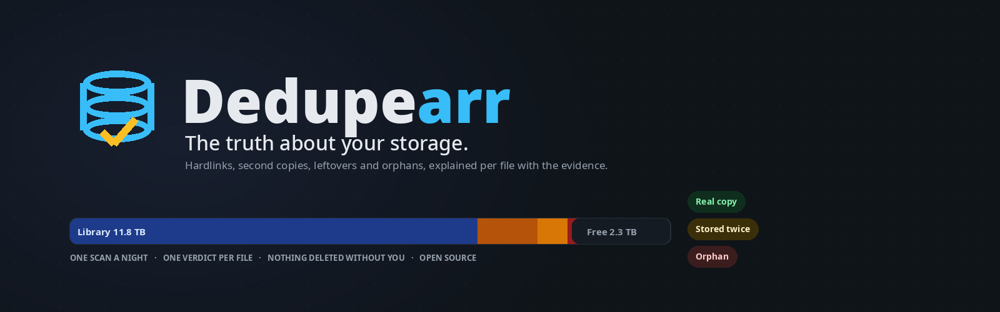
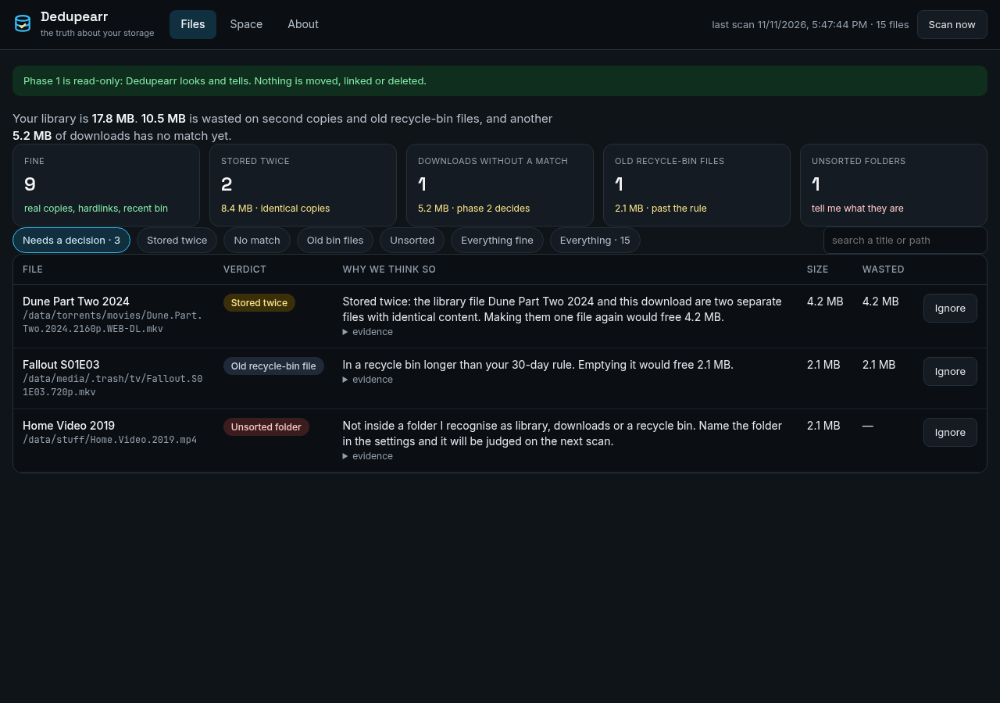
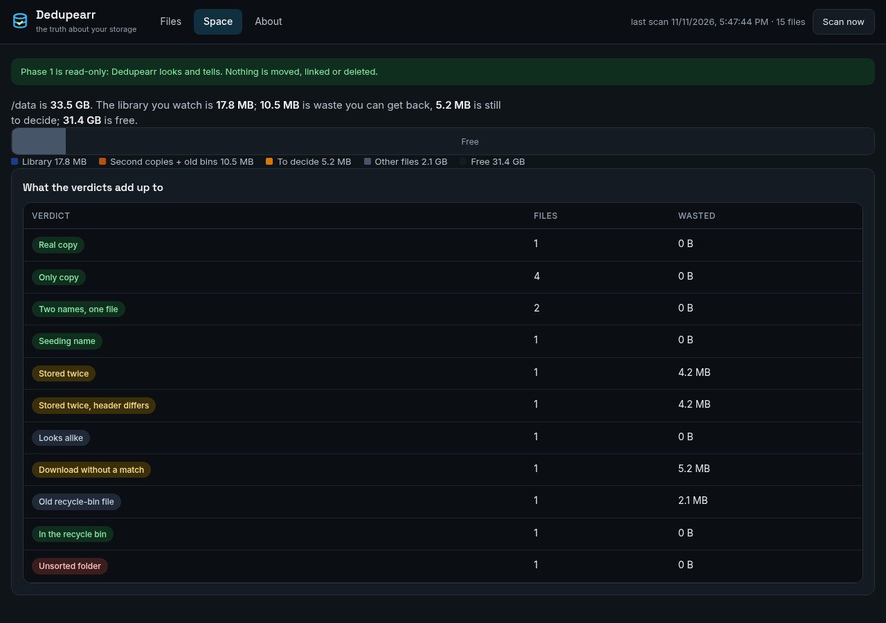
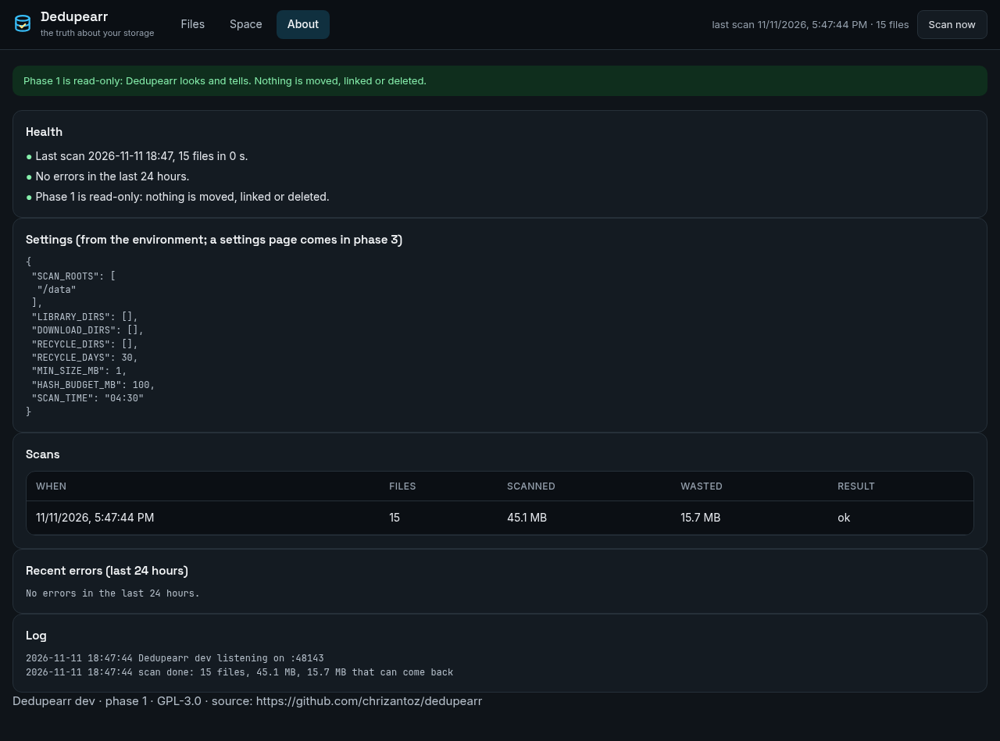
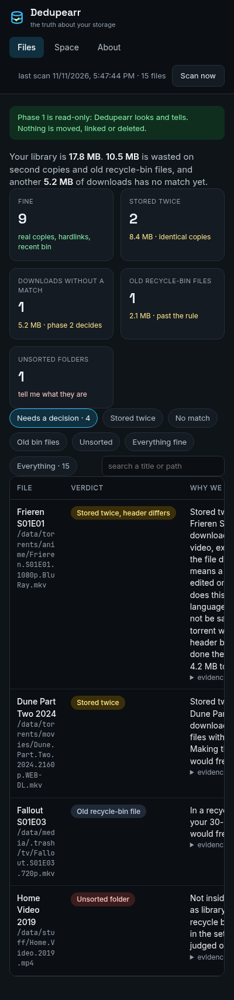
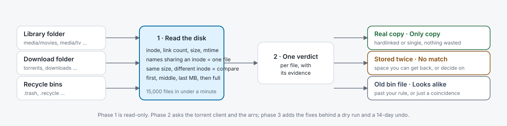

# 💾 Dedupearr



[](https://github.com/chrizantoz/dedupearr/actions/workflows/ci.yml) [](https://github.com/chrizantoz/dedupearr/releases) [](LICENSE) [](docs/INSTALL.md) [](https://dedupearr-demo.chrizantoz.com) [](https://github.com/chrizantoz/dedupearr/pkgs/container/dedupearr)

**Dedupearr tells you the truth about your storage.** If you run **Sonarr**, **Radarr** and a torrent client, your download folder is supposed to share its files with your library through *hardlinks* (two names for one file on disk), so seeding costs no extra space. One wrong path, one copy instead of a link, one upgrade that left the old torrent behind, and the same movie sits on your disk twice. Dedupearr walks every video file each night and says what it *is*, with the evidence, in one plain sentence.

Think of it as the companion to [Auditarr](https://github.com/chrizantoz/auditarr): Auditarr asks *is this file good?*, Dedupearr asks *is this file real and needed?*

- 🧪 **Try it in your browser:** **[dedupearr-demo.chrizantoz.com](https://dedupearr-demo.chrizantoz.com)** is the real app on a fake disk with one of every situation; every button works and it resets on the hour. A static copy of the page lives on the [project site](https://chrizantoz.github.io/dedupearr/).
- 📘 **New here? Start with the [User guide](docs/USER-GUIDE.md)**: a plain-language tour of the page and every button.
- 📋 **Every verdict it gives and every button it has:** [FEATURES.md](FEATURES.md)
- 📰 **What changed and when:** [CHANGELOG.md](CHANGELOG.md)
- 🗺️ **Where it is going:** [ROADMAP.md](ROADMAP.md) · 📦 **Installing step by step:** [docs/INSTALL.md](docs/INSTALL.md)

It is deliberately small: one Python file, one HTML page, a local SQLite file for its state, and no separate database server. It runs as a single Docker container.

## 🚧 Status

**Phase 2 of 4, still read-only.** Dedupearr looks and tells; it moves, links and deletes nothing. It was built on one homelab (about 15,000 files and 38 TB across Sonarr, Radarr and qBittorrent on Unraid) and its first real scan already found 370 GB of second copies. The next phases add the download-client and arr readers, then the fixes behind a dry run and a 14-day undo. The [roadmap](ROADMAP.md) has the detail.

| Phase | What it does | Status |
| --- | --- | --- |
| 1 · Scan and tell | Disk scan (inode, link count, size, checksum), verdicts, Files and Space pages, nightly scan | done |
| 2 · Ask the apps | Deluge, NZBGet, qBittorrent and the arrs' import history: a download becomes *leftover*, *orphan* or *seeding only*, with your seeding rule saying what can go now | **this release** (rTorrent, Transmission, SABnzbd to come) |
| 3 · Fix safely | Relink, remove the old torrent, empty the bin: dry run first, holding bin, 14-day undo | after 2 |
| 4 · Easy to install | Setup wizard with the shared-mount test, Unraid cache/array awareness, Unraid Apps, public demo | after 3 |

## 🖼️ Screenshots

Taken by the test bot in CI from the fake disk, so they are always current.

| Files: one verdict per file, with the evidence | Space: where the gigabytes went |
|---|---|
|  |  |

| About: health, settings, every scan | On a phone |
|---|---|
|  |  |

The page follows your system theme; a light version is one setting away.

## 🧭 How it works

<picture><source media="(prefers-color-scheme: dark)" srcset="docs/how-it-works-dark.svg"></picture>

Every night it records every video file's inode, link count and size. Names that share one inode are one file, so a library file and its seeding torrent that are hardlinked cost nothing and are marked **Real copy**. A download that has the same size as a library file is compared by checksum: identical means **Stored twice**, identical except the first megabyte means **Stored twice, header differs** (a language tag was edited on one copy), different means **Looks alike**. A download nothing matches is a **Download without a match** until phase 2 asks the torrent client about it. Recycle-bin files past your rule are **Old recycle-bin files**. Every verdict comes with one plain sentence and one line of evidence.

## 🧰 What you'll need

- Sonarr and/or Radarr with a torrent client, writing to a folder Dedupearr can read. Nothing is connected in phase 1; it only reads the disk.
- Your library **and** your download folder visible through **one mount** (`/data` below), the way the arr guides set it up. If they are two mounts, a hardlink between them cannot exist and Dedupearr cannot see that two names are one file.
- About two minutes to fill in the `docker run` command below.

### Try it without installing

**[dedupearr-demo.chrizantoz.com](https://dedupearr-demo.chrizantoz.com)** runs the real app on the fake disk below, on its own network, and rebuilds itself every hour. `sandbox/run.sh up` starts the same playground on your machine.

### Try it without a library

```bash
python3 tests/fake_disk.py /tmp/dedupearr-fake
CONFIG_DIR=/tmp/dedupearr-cfg SCAN_ROOTS=/tmp/dedupearr-fake MIN_SIZE_MB=1 python3 dedupearr.py --scan
```

The fake disk holds one of every situation: a real hardlink, an identical second copy, a copy whose header was edited, an unmatched download, a lookalike, an old and a recent recycle-bin file, two names inside the library, and an unsorted folder.

## How it works in three steps

1. 🔗 **Mount** the share that holds your library and your downloads, read-only, and start the container.
2. 🌙 **It scans every night** (and once at start): 15,000 files take under a minute. Checksums run only on files that look like copies and are remembered, so a file is hashed once in its life.
3. 👀 **You read one sentence per file**: *Stored twice: the library file Dune Part Two 2024 and this download are two separate files with identical content. Making them one file again would free 48.2 GB.* In phase 1 you act on it yourself; phase 3 adds the button.

### What it runs on

Inside the container: Python 3.12 and its standard library, nothing else. No database server, no framework. The test bots need Node 20 with `jsdom` and `playwright` (see `uibot/package.json`); none of that ships in the image.

## 🚀 Quick start (Docker)

```bash
docker run -d --name dedupearr --restart unless-stopped -p 3092:3092 \
  -e TZ=America/Winnipeg -v /path/to/appdata/dedupearr:/config -v /path/to/media:/data:ro \
  ghcr.io/chrizantoz/dedupearr:latest
```

Open `http://host:3092`. The first scan starts on its own; after that it runs every night at `SCAN_TIME` (04:30 by default).

Step-by-step for Unraid and docker compose: [docs/INSTALL.md](docs/INSTALL.md). A compose file is in [docs/docker-compose.yml](docs/docker-compose.yml), an Unraid template in [docs/unraid-template.xml](docs/unraid-template.xml).

📁 **Requirements:** the library and the download folders must be inside the one mount (`/data` here). Dedupearr tells library from downloads from recycle bins by folder names (`media`, `movies`, `tv`, `torrents`, `downloads`, `.trash`, `.recycle`, …); when your names differ, say so with `LIBRARY_DIRS`, `DOWNLOAD_DIRS` and `RECYCLE_DIRS`.

## 💬 Help and community

- [GitHub Discussions](https://github.com/chrizantoz/dedupearr/discussions) for questions and ideas, [Issues](https://github.com/chrizantoz/dedupearr/issues) for bugs.
- Unraid users: the Auditarr [support thread](https://forums.unraid.net/topic/201247-support-auditarr-nightly-quality-control-for-your-sonarr-radarr-bazarr-plex-library/) covers Dedupearr too until it has its own.

## 🔒 Who can open the page

Out of the box the page is open to whoever can reach the port, which at home means your local network. Set `AUTH_USER` and `AUTH_PASSWORD` and it asks for a sign-in (a plain login page, a signed session cookie, **Sign out** in the top bar; changing the password signs every browser out). `/health` stays open for monitoring.

- **No sign-in at home, sign-in through your domain:** add `LOCAL_NO_LOGIN=1`. A browser on your own network (or tailnet) that opens the address and port directly gets straight in; anything that arrives through a reverse proxy, tunnel or CDN (it adds `X-Forwarded-For` or a similar header) is always asked, even though the proxy itself sits on your network.
- **Already behind Authelia or Authentik:** `TRUST_PROXY_AUTH=1` lets their `Remote-User` header count as the sign-in, so you log in once.

## 🛡️ Is it safe? (yes: phase 1 changes nothing)

- **Read-only, by construction.** The container mounts your media read-only (`:ro`) and the code has no code path that moves, links or deletes a file. The banner on the page says so.
- **Verdicts need evidence.** A hardlink is a shared inode across the library and the download folder. "Stored twice" needs identical content, confirmed by checksum. "Looks alike" is a same-size file whose content differs, and it is never called waste.
- **When the fixes come (phase 3)** they follow Auditarr's rules: dry run on by default, files move to a holding bin instead of being deleted, 14 days of one-click undo, and a verdict that is unsure gets no button.

## ⚙️ Settings

Phase 1 reads its settings from the environment; the About tab shows them (never a key or a password: there are none). A settings page comes with phase 2.

| Setting | Default | Meaning |
| --- | --- | --- |
| `SCAN_ROOTS` | `/data` | Comma-separated folders to scan |
| `LIBRARY_DIRS`, `DOWNLOAD_DIRS`, `RECYCLE_DIRS` | empty | Explicit folders when the names below do not fit |
| `LIBRARY_HINTS` | `media,library,movies,tv,shows,series,anime,…` | Folder names that mean "library" |
| `DOWNLOAD_HINTS` | `torrents,downloads,complete,incomplete,usenet,…` | Folder names that mean "downloads" |
| `RECYCLE_HINTS` | `.recycle,.trash,recycle,trash,#recycle,…` | Folder names that mean "recycle bin" |
| `RECYCLE_DAYS` | `30` | Bin files older than this are waste |
| `MIN_SIZE_MB` | `50` | Smaller files are not judged |
| `HASH_BUDGET_MB` | `20000` | Full checksums per scan; beyond it duplicates are called "very likely" from samples |
| `SCAN_TIME` | `04:30` | Nightly scan time (container TZ) |
| `SONARR_URL`, `SONARR_APIKEY` (also `RADARR_*`, `WHISPARR_*`, `SPORTARR_*`, `LIDARR_*`) | empty | Lets Dedupearr read the arr's import history: which download became which library file |
| `DELUGE_URL`, `DELUGE_PASSWORD` | empty | Deluge web address (`http://host:8112`) and its web password |
| `NZBGET_URL`, `NZBGET_USER`, `NZBGET_PASSWORD` | empty | NZBGet address (`http://host:6789`) and its control login |
| `QBIT_URL`, `QBIT_USER`, `QBIT_PASSWORD` | empty | qBittorrent web address and login |
| `FIX_MODE`, `HOLDING_DIR`, `HOLD_DAYS` | `dryrun`, `<first root>/.dedupearr-holding`, `14` | What a fix may do: `off`, `dryrun` (show the steps, change nothing) or `on` (arrives fix by fix in phase 3); where moved files wait and for how long before deletion |
| `SEED_MIN_RATIO`, `SEED_MIN_DAYS`, `SEED_RULE` | `1.0`, `14`, `both` | Your seeding rule: a torrent is "done" when the ratio **and** the days are reached (`both`, safe for private trackers) or when one of them is (`either`); then a leftover or second copy "can go now" |
| `CLIENT_PATH_MAP` | empty | `clientpath=ourpath,…` when a client sees the files under another path than Dedupearr does |
| `AUTH_USER`, `AUTH_PASSWORD` | empty | Turn the sign-in on |
| `LOCAL_NO_LOGIN` | `0` | `1` = no sign-in for a browser on your own network talking to the port directly; through a domain it still asks |
| `TRUST_PROXY_AUTH` | `0` | `1` = a reverse proxy's `Remote-User` header counts as signed in |
| `PORT` | `3092` | Web port |

## 🧑‍💻 For developers

🧪 **Testing** (full write-up: [docs/TESTING.md](docs/TESTING.md)): a fake disk with every situation, verdict and plain-language tests, an API contract test that records the UI fixtures, a random-disk fuzzer, chaos, mutation and performance checks, a jsdom UI bot on five edge worlds, a data fuzzer, bot lints and a real-browser bot with screenshots. CI runs all of it on every push and publishes the image only when it is green.

🗂️ **Project layout**

```
dedupearr.py    the whole backend (scanner, verdicts, scheduler, HTTP API)
ui.html         the whole UI
tests/          fake disk, verdict / plain-language / API / fuzz / chaos / mutation / perf tests
uibot/          headless UI bot, data fuzzer, edge worlds, real-browser bot, lints, fixtures
docs/           install and user guides, Unraid template, compose file, banner generator
```

Built for a single homelab; shared as-is. Issues and ideas welcome.

## ☕ Support

Dedupearr is free and stays free. If it gave you a terabyte back, a tip helps pay for the test hardware behind the next release.

[](https://github.com/sponsors/chrizantoz) [](https://ko-fi.com/chrizantoz)

## 📄 License

GPL-3.0. Use it, change it, share it; anything you distribute based on it must stay open under the same terms. See [LICENSE](LICENSE).
